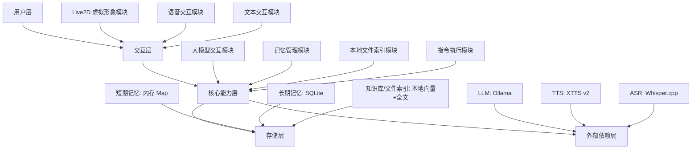

# Norma - 诺玛

> 一个基于 Golang + Live2D 的桌面人格化伴侣开源项目。

Norma 的目标是实现：**轻量本地部署 + 高拟人化体验 + 极简架构**。

- 单机本地运行，隐私优先
- 无 Redis / 无复杂中间件依赖
- 用户双击可执行文件即可启动

## 项目定位

Norma 以 Golang 为核心，结合 Live2D、语音交互与本地大模型能力，打造可持续陪伴的桌面虚拟人格伙伴。

核心目标：

1. 高拟人化形象交互：支持动作、表情、口型同步
2. 文本 + 语音双通道：自定义唤醒词、语音识别、拟人语音合成
3. 记忆与知识增强：长短时记忆 + 本地文件索引 + RAG
4. 极简部署：单可执行文件运行，低资源占用

## 核心特性

### 1. 虚拟形象（Live2D）
- 基于 Wails + Live2D Cubism SDK
- 支持透明悬浮、置顶显示、非交互鼠标穿透
- 内置待机/交互/情绪/口型同步动作系统

### 2. 语音交互
- 唤醒词：Porcupine（离线本地）
- 语音识别：Whisper.cpp（Golang 绑定）
- 语音合成：XTTS v2（本地服务）
- 支持情绪、语速、语调控制与口型联动

### 3. 大模型与记忆
- 优先接入本地 Ollama（支持云端 API 备选）
- 短期记忆：内存 Map（最近 20 轮）
- 长期记忆：SQLite（偏好/摘要/重要信息）

### 4. 本地文件智能索引
- 增量监听：fsnotify
- 混合检索：向量检索 + 全文检索
- 支持将本地文档内容注入 LLM 上下文进行回答

## 架构设计

## 技术栈

- 核心语言：Golang
- 桌面框架：Wails（WebView2）
- 虚拟形象：Live2D Cubism SDK
- 大模型：Ollama（本地优先）
- 语音唤醒：Porcupine
- 语音识别：Whisper.cpp
- 语音合成：XTTS v2
- ORM：XORM
- 数据库：SQLite（modernc.org/sqlite）
- 配置管理：Viper
- 存储：内存 + SQLite + 本地索引文件

## 部署目标

- 打包形态：单可执行文件（Windows/macOS/Linux）
- 配套资源：模型文件与索引文件同目录打包
- 启动方式：一键启动脚本自动拉起依赖服务 + 主程序
- 用户体验：双击即可启动

## 硬件建议

- 最低配置：4 核 CPU / 8GB RAM / 10GB 可用磁盘
- 推荐配置：8 核 CPU / 16GB RAM / 独立显卡（可选，用于加速）

## 路线图（完整产品）

### Phase 0：基础治理（第 1-2 周）
1. 全仓 UTF-8 治理与编码门禁
2. 文档与代码状态对齐
3. 全链路 trace 与指标基线

### Phase 1-2：交互内核与语音闭环（第 3-6 周）
1. 状态机/事件总线/取消机制产品化
2. 流式 ASR + 分句流式 TTS + 可打断
3. AEC/NS 与双模式唤醒（VAD / Wake Word）

### Phase 3-4：RAG 与记忆产品化（第 7-10 周）
1. Hybrid Retriever（HNSW + FTS5 + RRF）主链路落地
2. 文档提取扩展（txt/md/pdf/docx）与结构化分块
3. STM/LTM 完整策略与可视化记忆管理

### Phase 5-7：体验打磨、发布工程、GA（第 11-16 周）
1. Live2D 情绪/动作/口型精细联动
2. 一键启动、自愈、分层日志、诊断包
3. 自动化测试矩阵 + Beta/RC/GA 发布节奏

## 项目原则

- **本地优先**：数据不出本机
- **极简优先**：减少依赖，降低部署复杂度
- **体验优先**：拟人化交互自然、稳定、低延迟
- **可扩展优先**：模块解耦，便于后续能力升级

## 当前状态（2026-03-06）

项目已进入“完整产品化推进”阶段，不再以 MVP 为目标。

当前已完成：
1. 核心文档体系（架构、语音、RAG、记忆、运维、测试）建立
2. 基础代码骨架与部分模块实现（详见仓库代码）
3. 完整产品开发计划已落地到 `TODO.md`

当前重点执行：
1. Phase 0 基础治理（UTF-8、文档同步、指标基线）
2. 主链路去 Mock（检索、语音链路）并补齐回归测试
3. 发布级质量门禁与跨平台交付能力建设